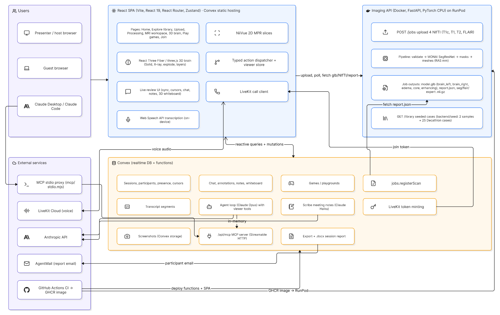

# Lobe

Lobe turns real brain MRIs into 3D models you can turn, slice and study together, then lets you practice on the same scans with quick games.

Upload a brain MRI (4 standard sequences) and a pretrained AI model (MONAI SegResNet) segments the tumor. Study the case in linked 2D slices and a 3D brain, invite others into a live review room with voice, chat, notes and a shared whiteboard, ask a Claude-powered assistant about what you are looking at, and get a session report by email when the meeting ends.

> **Educational visualization only — not clinically validated.** Lobe does not diagnose, plan surgery, or give medical advice. The tumor is shown where the model segmented it, in the scan's own coordinates. JPG/PNG images are not accepted: they don't contain 3D scan data.

Built at **CalHacks 13.0** (36 hours).

## Features

| Area | What ships |
|------|------------|
| **Home** `/` | Workspaces saved in this browser, join-by-invite box, daily brain fact. |
| **Upload → Processing** `/upload`, `/jobs/:id/processing` | 4 NIfTI slots (T1c, T1, T2, FLAIR), non-NIfTI files refused, 1 s status polling through backend stages. |
| **Case library** `/explore` | 27 ready-made Decathlon cases (2 samples + 25 library cases), filter by side and size, open in one click with no upload or inference. |
| **MRI workspace** `/jobs/:id/mri` | NiiVue multi-planar slices (axial / coronal / sagittal) with the tumor overlay, case info (volumes, side, lesion count, expert Dice on seeded cases, outline certainty, limitations), notes pinned to the scan. |
| **3D brain** `/jobs/:id/3d` | React Three Fiber scene: Solid / X-ray with opacity, explode slider that pulls hemispheres apart, per-layer toggles (edema, core, enhancing), hide / focus a hemisphere, reset view. |
| **Live review** `/join/:code` | Invite link + QR code, synced camera / slices / scene, follow-the-presenter, face pile + live 3D cursors, room chat, threaded notes, 3D whiteboard (stickies, text, pen strokes, highlight; undo/redo and keyboard shortcuts). |
| **Live call** | Group voice call via LiveKit; live transcript from the browser's Web Speech API (no audio leaves the device; host toggles it). |
| **AI assistant** | In-app Claude agent (`claude-opus-5-5`) that answers questions and drives the viewer through typed tools (zoom, rotate, isolate, set mode, explode, opacity, screenshot, undo…). A Scribe agent (`claude-haiku-5-5`) keeps rolling meeting notes. Medical-advice requests are refused. |
| **Session report** | When a session ends, members who left an email get a `.docx` report (findings, notes, chat, transcript summary, screenshots) via AgentMail. Markdown export is also available. |
| **Games** `/play`, `/play/join/:code` | Find the slice, Beat the AI (outline vs expert, Dice-scored), Which side?, Bigger or smaller. Solo, or a multiplayer playground with host-revealed answers and a leaderboard. |
| **MCP server** | `/api/mcp` on Convex exposes case reports, anatomy, chat, annotations and export to Claude Desktop / Claude Code through a stdio proxy. See [`mcp/README.md`](mcp/README.md). |

**Not yet built:** Cutaway mode (exists in the action model, no UI), hand-gesture control, "Jarvis" voice commands.

## Architecture



<details>
<summary>Text version</summary>

```
                    4 NIfTI sequences (T1c, T1, T2, FLAIR)
                                   │
                                   ▼
┌─────────────────────────── Imaging service (backend/) ───────────────────────────┐
│ Docker · FastAPI · PyTorch CPU                                                   │
│ validate → SegResNet → masks → meshes (RAS mm)                                   │
│   model.glb   brain_left · brain_right · edema · core · enhancing                │
│   report.json volumes, centroid, side, lesion count, certainty, expert Dice      │
│   seg.nii.gz · flair.nii.gz · expert.nii.gz (seeded cases)                       │
│ Seeded cases in backend/seed/ are copied to jobs/ on startup                     │
│ Prod: image on GHCR → RunPod pod                                                 │
└──────────────────────────────────────────────────────────────────────────────────┘
          ▲ REST (VITE_API_URL)                      ▲ report fetch
          │                                          │
┌─────────┴──────────── React app (frontend/) ─┐   ┌─┴──────────── Convex (convex/) ──────────────┐
│ Vite · React 19 · React Router · Zustand     │◄─►│ Realtime DB + functions, hosts the built SPA │
│ NiiVue 2D slices · R3F/three.js 3D           │   │ sessions · presence · cursors · chat · notes │
│ pointer / keys / agent → one typed dispatcher│   │ whiteboard · games · transcript · exports    │
│ LiveKit client · Web Speech transcription    │   │ agent loop (Anthropic) · Scribe notes        │
└──────────────────────────────────────────────┘   │ LiveKit token minting · AgentMail report     │
          ▲ voice                                  │ /api/mcp (MCP over Streamable HTTP)          │
          ▼                                        └──────────────────────────────────────────────┘
     LiveKit Cloud                                                   ▲
                                              mcp/stdio.mjs ── Claude Desktop / Claude Code
```

</details>

Brain and tumor meshes come from the **same scan and affine**, so they share one coordinate frame and no template registration is needed. See SPEC §5.

## Quickstart

Prerequisites: Docker, Node 22, and (for collaboration) a Convex account.

```bash
# 1. Imaging service (from the repo root)
docker compose up --build            # http://localhost:8000/health

# 2. Convex backend (repo root, second terminal) — optional, enables sharing/call/agent
npm ci
npx convex dev                       # writes CONVEX_URL to .env.local

# 3. Frontend (third terminal)
cd frontend && npm install
echo "VITE_CONVEX_URL=<CONVEX_URL from step 2>" > .env.local   # skip to run without Convex
npm run dev                          # http://localhost:5173
```

- `VITE_API_URL` is optional; it defaults to `http://localhost:8000`. Backend CORS allows `http://localhost:5173`, so use `localhost`, not `127.0.0.1`.
- Without `VITE_CONVEX_URL`, upload, library, MRI/3D viewing and solo games work; sharing, call, chat, agent and playgrounds are disabled.
- `docker-compose.yml` pins `linux/arm64` (Apple Silicon). On x86 hosts, remove the `platform` line.
- Click a **sample case** or a library case to skip inference. A real 4-sequence upload took about 90 s on CPU in [browser verification](docs/qa/2026-10-24-milestone-b/README.md).

### Convex server environment

Set with `npx convex env set NAME value`. Every feature degrades gracefully when its variables are missing.

| Variable | Used by |
|----------|---------|
| `NEUROVISION_API_URL` | `jobs.registerScan`: imaging-service URL reachable from Convex, so uploaded cases can be shared |
| `ANTHROPIC_API_KEY`, `AGENT_DAILY_RUN_LIMIT` | AI assistant and Scribe notes |
| `LIVEKIT_URL`, `LIVEKIT_API_KEY`, `LIVEKIT_API_SECRET` | Live call |
| `AGENTMAIL_API_KEY`, `AGENTMAIL_INBOX_ID` | Emailed session report |
| `MCP_TOKEN`, `IMAGING_API_URL` | MCP endpoint (service token; report source) |

Imaging service: `ALLOWED_ORIGINS`, `JOBS_DIR`, `KEEP_JOBS`, `PORT`.

## Tests and CI

```bash
npm test                              # Convex functions (vitest + convex-test) and MCP proxy
npm run typecheck                     # Convex TypeScript
cd frontend && npm run lint && npm test && npm run build
cd backend && uv sync && uv run pytest -q
```

[`.github/workflows/ci.yml`](.github/workflows/ci.yml) runs all three suites on every push and PR. On `main` it deploys Convex functions plus the built frontend to Convex static hosting, and, when `backend/` changed, builds the API image to GHCR and rolls the RunPod pod onto it. Required secrets and variables are listed at the top of the workflow.

## Repo layout

```
frontend/src/
  routes/       pages (Home, Explore, Upload, Processing, MriWorkspace, Brain3D, Play, Join)
  viewer/       R3F 3D canvas, NiiVue MPR panel, RAS transforms
  actions/      typed action dispatcher + viewer store
  share/        live review: sync, presence, cursors, chat, notes
  board/        3D whiteboard tools
  call/         LiveKit call controls
  agent/        transcription, Scribe meeting notes, screenshots
  games/ play/  study games and multiplayer playground
  api/          imaging-service client
convex/         realtime backend: schema, sessions, agent/, mcp/, lib/, tests/
mcp/            stdio proxy for Claude Desktop / Claude Code
backend/        FastAPI + MONAI SegResNet + mesh export (Docker)
  seed/         pre-built sample and library cases
  scripts/      build_library, make_sample, split_decathlon, runpod_check
  atlas/        CerebrA anatomy atlas builder
test-harness/   throwaway Convex reactivity page
docs/           spec, contracts, design specs/plans, QA reports
```

## Docs

| Doc | What it's for |
|-----|---------------|
| [`docs/SPEC.md`](docs/SPEC.md) | Scope, locked decisions, contracts, timeline |
| [`docs/BACKEND_CONTRACT.md`](docs/BACKEND_CONTRACT.md) | Imaging API, `model.glb` node names, report JSON, Docker |
| [`docs/CONVEX_BACKEND.md`](docs/CONVEX_BACKEND.md) | Convex data model, auth model, function reference |
| [`docs/AGENT_CORE.md`](docs/AGENT_CORE.md) | In-app agent loop, tools and guardrails |
| [`mcp/README.md`](mcp/README.md) | MCP tools, auth, Claude Desktop setup |
| [`docs/superpowers/`](docs/superpowers/) | Feature design specs and implementation plans |
| [`docs/qa/`](docs/qa/) | Browser verification reports |
| [`CONTRIBUTING.md`](CONTRIBUTING.md) | Lanes, labels, branch/PR flow |
| [Issues](https://github.com/DuongAnh1201/Lobe/issues) · [Milestones](https://github.com/DuongAnh1201/Lobe/milestones) | All work, grouped by checkpoint |

## Data & credits

- Model: [MONAI Model Zoo `brats_mri_segmentation`](https://github.com/Project-MONAI/model-zoo) (SegResNet, Apache-2.0, trained on BraTS 2018).
- Cases: [Medical Segmentation Decathlon](http://medicaldecathlon.com/) Task01_BrainTumour, CC-BY-SA 4.0. See [`data/sample/LICENSE`](data/sample/LICENSE) and [`backend/seed/README.md`](backend/seed/README.md).
- Anatomy atlas: CerebrA (used by the MCP `explain_structure` tool).
- Services: Convex, LiveKit, Anthropic Claude, AgentMail, RunPod.
- Libraries: MONAI, PyTorch, FastAPI, nibabel, scikit-image, trimesh, React, Three.js / React Three Fiber, NiiVue, Zustand, MCP SDK.

## License

Code: [Apache-2.0](LICENSE). Dataset files keep their original license.
